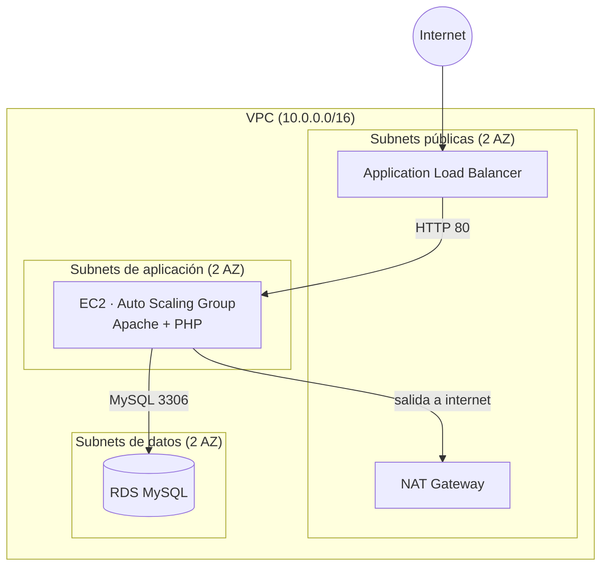

# 3-tier web app en AWS con Terraform

Infraestructura como código para una aplicación web de tres capas en AWS (balanceador, servidores con autoescalado y base de datos), con dos entornos aislados (`stage` y `prod`) que reutilizan un mismo módulo y guardan su state en S3.

La app de prueba es una página PHP que muestra en qué zona de disponibilidad se está sirviendo la petición y permite guardar registros en la base de datos. Al refrescar a través del balanceador se ven registros de las dos AZ, lo que demuestra el reparto de carga y la conexión a RDS.

## Arquitectura



- **Tier 1:** un ALB público en dos subnets públicas, una por AZ. Es el único recurso que recibe tráfico de internet.
- **Tier 2:** instancias EC2 en un Auto Scaling Group (mínimo 2, repartidas entre las dos AZ) en subnets privadas. Salen a internet por el NAT para instalar paquetes, pero nadie puede iniciar una conexión hacia ellas.
- **Tier 3:** RDS MySQL en subnets privadas dedicadas, sin IP pública.
- **Seguridad:** security groups encadenados. El ALB acepta HTTP desde internet, las EC2 solo aceptan tráfico del SG del ALB, y RDS solo acepta el puerto 3306 desde el SG de las EC2.

## Qué despliega

- VPC con 6 subnets en 2 AZ (2 públicas, 2 de aplicación y 2 de datos), internet gateway, NAT gateway y route tables separadas (pública y privada).
- Application Load Balancer con listener HTTP y target group con health check.
- Launch template y Auto Scaling Group (`health_check_type = "ELB"`, así que las instancias que no responden se reemplazan).
- RDS MySQL 8.0 cifrada en reposo (`storage_encrypted`), con subnet group propio, autenticación IAM activada (`iam_database_authentication_enabled`) y la contraseña del usuario maestro generada y rotada por RDS en AWS Secrets Manager (`manage_master_user_password`).
- Tres security groups y un role de IAM con su instance profile, con permiso `rds-db:connect` (solo para el usuario `webapp`) y permiso para leer el secreto del usuario maestro.
- `user_data` que instala Apache, PHP y el AWS CLI y, al arrancar, usa el usuario maestro una sola vez para crear la tabla y el usuario `webapp` (con el plugin de autenticación IAM y permisos solo de `SELECT` e `INSERT`). Después publica la aplicación, que se conecta como `webapp` con un token de IAM, sin contraseña, y verificando el certificado de RDS.

## Estructura del repositorio

```
modules/               módulo reutilizable con toda la infraestructura
stage/                 entorno de pruebas (us-east-1), con su propio backend y state
prod/                  entorno de producción (us-east-2), con su propio backend y state
s3_backend_origin/     crea el bucket de S3 donde se guardan los states (bootstrap, state local)
```

`stage/` y `prod/` son módulos raíz: cada uno define su provider, su backend y las variables que cambian respecto al otro, y llama al mismo módulo. Cada uno tiene un state independiente (una `key` distinta en el mismo bucket), de modo que aplicar uno nunca afecta al otro.

## Diferencias entre entornos

| | stage | prod |
|---|---|---|
| Región | us-east-1 | us-east-2 |
| RDS Multi-AZ | no | sí |
| Protección contra borrado | no | sí |
| Retención de backups | 0 días | 7 días |

Son variables del módulo sin valor por defecto: Terraform obliga a decidirlas explícitamente en cada entorno, así que no se puede desplegar prod con la configuración de stage por olvido. El cifrado de RDS está activado en ambos.

## Cómo desplegar

**Requisitos:** Terraform >= 1.10 (el backend usa el bloqueo nativo de S3 con `use_lockfile`, sin DynamoDB), AWS CLI con credenciales configuradas y permisos sobre los servicios anteriores. No hay que definir ninguna contraseña: la genera RDS.

1. **Crear el bucket de state** (una sola vez):

   ```
   cd s3_backend_origin
   terraform init
   terraform apply
   ```

   Después, usa el nombre del bucket en el bloque `backend "s3"` de `stage/terraform.tf` y `prod/terraform.tf`.

2. **Desplegar un entorno:**

   ```
   cd stage
   terraform init
   terraform plan
   terraform apply
   ```

3. **Probar:** abre el valor del output `alb_dns` en el navegador, con `http://` (no hay HTTPS). La RDS tarda unos 10 minutos y las instancias unos minutos más en pasar el health check; hasta entonces el ALB devuelve 503.

4. **Destruir al terminar:**

   ```
   terraform destroy
   ```

   En `prod`, `deletion_protection` está activo: hay que ponerlo en `false`, hacer `apply` y entonces `destroy`.

## Coste

El NAT gateway, el ALB y la RDS cobran por hora aunque no reciban tráfico. El NAT supone por sí solo unos 30-35 $ al mes, y prod con Multi-AZ duplica el coste de la base de datos. Ejecuta `terraform destroy` cuando termines de probar y comprueba en la consola que no quedan huérfanos el NAT, la Elastic IP, el ALB, la RDS ni las EC2.

## Estado del proyecto

- **stage:** desplegado, probado y destruido. La aplicación responde a través del ALB y guarda registros en RDS desde ambas AZ, conectando con IAM auth.
- **prod:** desplegado, probado y destruido en us-east-2, con RDS Multi-AZ (antes de añadir IAM auth; solo se ha probado esta versión en stage).

## Cómo se conecta la aplicación a la base de datos

1. La instancia descarga el bundle de certificados de RDS (`/etc/webapp/rds-ca.pem`).
2. Con la contraseña del usuario maestro (leída de Secrets Manager) crea la tabla y el usuario `webapp` (`AWSAuthenticationPlugin`, `REQUIRE SSL`, solo `SELECT` e `INSERT`). Es idempotente: si ya existen, no hace nada.
3. Un cron genera cada 5 minutos un token de IAM para `webapp` (válido 15 minutos) y lo guarda en `/etc/webapp/db.token` (propietario root, grupo `www-data`, permisos 640).
4. La página PHP lee ese token y lo usa como contraseña en una conexión SSL con verificación del certificado.

## Decisiones y limitaciones conocidas

- **Las EC2 siguen pudiendo leer la contraseña del usuario maestro.** La aplicación ya no usa contraseña (entra como `webapp` con tokens de IAM de 15 minutos, que son lo único que queda en disco), pero el bootstrap del usuario `webapp` se hace desde el `user_data` con el usuario maestro, así que el role de las instancias conserva el permiso de leer ese secreto. Si una EC2 se comprometiera, un atacante podría leerlo y entrar como `admin`. La mejora es sacar el bootstrap de las EC2 (por ejemplo, una Lambda dentro de la VPC invocada desde Terraform con `aws_lambda_invocation` y con su propio role) y quitarles ese permiso.
- **El usuario `webapp` se crea en cada despliegue.** La base de datos se recrea con cada `destroy`/`apply`, y las instancias vuelven a ejecutar el bootstrap. El `user_data` solo se ejecuta al crear una instancia: cambiar la plantilla no afecta a las que ya existen hasta que se reemplazan.
- **Un único NAT gateway.** Está en una sola AZ: si esa AZ cae, las instancias de la otra pierden la salida a internet. Es suficiente para un laboratorio, y la versión de alta disponibilidad (un NAT por AZ) multiplica el coste.
- **Solo HTTP.** El listener escucha en el puerto 80. HTTPS exigiría un dominio y un certificado en ACM.
- **Salida de las EC2 abierta a internet** (puertos 80 y 443 hacia `0.0.0.0/0`: el 80 para `apt` y el 443 para la API de Secrets Manager y para descargar el bundle de certificados de RDS), porque los mirrors de paquetes no tienen IP fija. Restringirla por dominio requeriría un proxy o AWS Network Firewall.
- **Sin NACLs.** Las security groups cubren la cadena ALB → EC2 → RDS, y las NACLs (stateless) añadirían complejidad sin una necesidad concreta.
- **`skip_final_snapshot = true`** en la RDS, pensado para un laboratorio que se destruye a menudo. En una producción real estaría en `false`.

## Siguientes pasos

- [x] Desplegar y validar `prod` en us-east-2.
- [x] Contraseña de RDS gestionada por AWS Secrets Manager (`manage_master_user_password`).
- [x] Autenticación IAM con un usuario `webapp` de privilegios limitados: la aplicación no usa ninguna contraseña.
- [ ] Bootstrap del usuario `webapp` fuera de las EC2 (Lambda) para retirarles el acceso al secreto del usuario maestro.
- [ ] Acceso a las instancias por SSM Session Manager, sin abrir SSH.
- [ ] HTTPS con ACM.
- [ ] Un NAT gateway por AZ.
